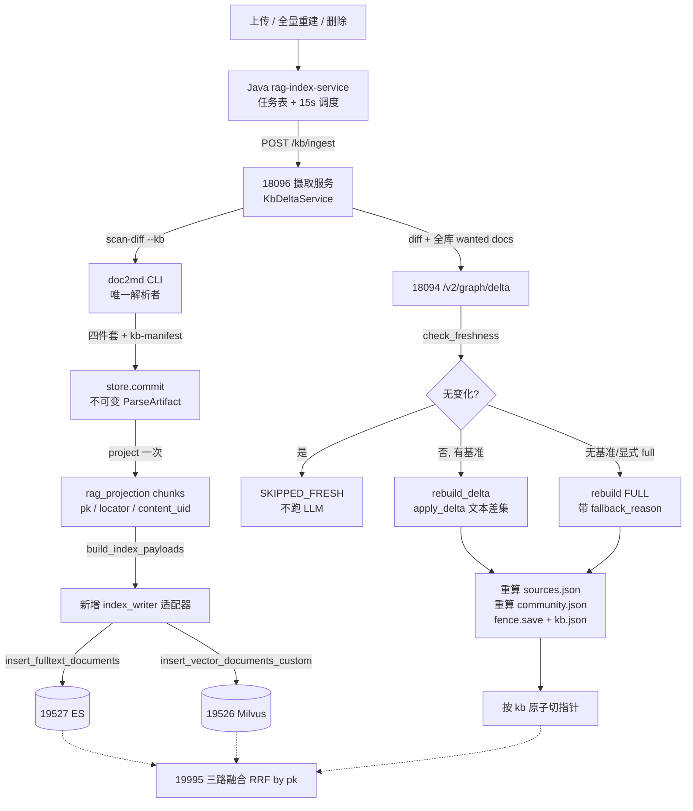

# 00 · 主设计方案：doc2md 唯一解析者 + 搜索/图谱同源 + HippoRAG 图谱增量

> 状态：**设计待评审 / 未开工**。本文所有「新增」「改造」均为设计方案，仓库中尚不存在对应实现。
> 术语：`ParseArtifact` = doc2md 四件套封成的不可变快照；`pk` = 平台整数 chunk 主键；`wanted texts` = 某库当前全部存活 chunk 的文本集合（引擎增量差集的基准）；`FULL` / `DELTA` / `SKIP` = 18094 重建模式。

---

## 1. Owner 三条要求 → 设计目标 → 可验收判据

| # | Owner 原话要点 | 本方案的设计目标 | 可验收判据（详见 `04-ACCEPTANCE.md`） |
|---|---|---|---|
| 1 | 彻底抛弃 12340 的 Java 原始文档解析，全量/增量一律走 doc2md | 停用 `remote.file-parse.*`，Java 派发目标改为 18096 摄取服务，其唯一解析者是 doc2md CLI；12340 服务、systemd、watchdog、`up.sh` 验收项全部下线 | A-1：上传任一 pdf/docx/xlsx/txt，12340 端口无进程、`/parse` 无流量；产物目录出现 doc2md 四件套且 `parse_manifest.status=SUCCESS`；A-2：全量重建与增量上传走同一入口 |
| 2 | doc2md 成为主解析者，搜索与图谱吃同一份四件套，增量真正接起来 | 一次 `store.commit()` → 一份不可变快照 → 同源派生 ES/Milvus 载荷与 BuildDoc；按库 diff 驱动下游，不再「回调即全量」 | B-1：三路写入的 `artifact_id`/`content_uid`/`content_hash` 一致；B-2：ES `_id` = Milvus `pk` = 图 `source.pk`（HR-01）；B-3：无变化回调返回 `SKIPPED_FRESH` 且不触发 LLM 抽取 |
| 3 | 利用 HippoRAG GraphRAG 特性设计图谱增量，解决无条件重建 | 新增 18094 增量端点，复用 `rebuild_delta` / `rebuild_by_policy` / `check_freshness` / `docs_fingerprint` / `FenceState`；DELTA 后重算 `sources.json` + `community.json` | C-1：新增 1 文件时 `effective_mode=DELTA`、`apply_result.reused == 原块数`、openie 只对新块跑；C-2：global 答案引用全部有效；C-3：删除文件先 fence 撤权再 DELTA；C-4：无基准快照/全撤权时显式拒绝或带 `fallback_reason` 走 FULL，不静默降级 |

---

## 2. 现状根因（评审请先核对 `01-EVIDENCE.md`）

### 2.1 doc2md 不在主解析链上

Java 把解析派给 `12340/parse`（`RemoteFileUtils.java:43-44,339-341`；`application-r12.yml:83-84`），请求体是 `ParseParam.java:17-138`，**不含任何 doc2md 字段**；12340 的 `server/api_param.py:9-50` 也不收 `doc2md_dir`。`FileParseTaskInfo.doc2mdDir`（`FileParseTaskInfo.java:162-169`）全仓**没有任何赋值点**，反序列化恒为 `null`。`services/rag-alg/alg_doc_parse_service/adapter_doc2md/adapter.py` 只被测试与设计文档引用，未接生产。

doc2md 只出现在**解析完成之后**的旁路 `v2-ingest`：`doSuccess`（`FileParseTaskAppServiceImpl.java:360-362`）→ `FileAppServiceImpl.v2Ingest` → `RemoteV2IngestUtils` → `18096 /kb/ingest`。而该服务**没有任何启动定义/看门狗**（`r12-watchdog.sh:57-71`、`algctl.sh:170`、`R12-ENV-CONTRACT.md:9-36` 均无 18096），部署版配置 `v2-ingest.url: ""`（`application-r12.yml:103-109`）。

### 2.2 搜索与图谱不同源

- 12340 一次 `_Parser.parse()` + 一次 `chunk()`，用同一个 `chunks` 变量双写 `19527` ES 与 `19526` Milvus（`controller.py:869-906`），主键同源；
- 图谱走另一条：Java `generateGraph`（`FileAppServiceImpl.java:664-758`）→ `19531 legacy_shim` → 从 **ES 全库**取块 → `18094 /v2/graph/build` 全量重建（2026-11-07 修复后）；
- V2 投影链路本可「一次快照双路消费」（`kb_pipeline.py:1-22`），但 `build_index_payloads` 产出的 `payloads` **没有任何落库消费者**，且 `kb_ingest_service.py:216-218` 默认把 `payloads` 从响应里 `pop` 掉；「投影载荷 → 19527/19526」的适配层在仓库中不存在。

即：**ES/Milvus 是 12340 的 legacy chunk，图谱是 ES 回读的 chunk，doc2md 四件套只在那条关闭的旁路里被消费**。

### 2.3 没有「发现更新」

`doSuccess` 收到 `success=true` 回调后，只要上传勾选了 `isGraphParse` 就触发 `generateGraph`（`:354-355`），没有文件集合/内容哈希/版本/时间戳比对，没有按 `graph_parse_status` 或指纹的短路；`messageId` 是随机 UUID 不参与去重。`isGraphParse` 来自上传勾选位，与「文件是否变化」无关——即「是否建图」由勾选位决定、而非「文件是否变化」，也没有文件级 diff 短路。

下游也没有短路：`api.py:377` 固定调 `_default_build`，`_default_build:219` 固定 `rebuild(root, fence, live, full_build, fencing=1)`；`rebuild_if_stale` / `check_freshness` / `rebuild_delta` / `rebuild_by_policy` **代码已存在但未接 HTTP**（只被 `scripts/v2_graph_worker.py:341-358` 与测试调用）。`api.py` 的 8 个端点里没有增量端点。

### 2.4 由此产生的三个必然后果

1. 上传 1 个文件 = 整个库重跑 LLM OpenIE；`STAGE5.md:86` 记录 kb_9 4566 doc 约 3.5h。
2. 重复上传同一文件、或解析回调重放，也会全量重建；LLM 抽取非确定，两次结果不同（`EVIDENCE-BASELINE-NOISE`）。
3. 全量重建是所有一致性的唯一保障，一旦引入增量就必须自己补齐 `sources.json`、`community.json`、fence、并发控制。

---

## 3. 必须继承的既有约束（评审核对表）

| 约束 | 出处 | 本方案如何继承 |
|---|---|---|
| 统一来源身份 = 整数 `pk`；ES `_id`/Milvus 主键/图 `source.pk` 三者一致；禁止 `chunk-<md5>` 进入 source/引用 | `11_VECTOR_STORE_AND_HYBRID_RETRIEVAL.md:20,57-61`；HR-01/HR-02 | §6 三路派生共用 `_chunk_pk`；§10 提供 pk 迁移方案 |
| 统一标准输入 = doc2md `ParseArtifact`（四件套 + IR + assets），下游不重解析原件 | `06_STANDARD_INPUT_AND_GRAPH_ENGINE.md:30-43`；`IMPLEMENTATION-QUEUE-V2.md:87` | §5/§6：唯一 `store.commit()`，投影只读快照 |
| 图读完整 MD/IR，不依赖 RAG chunk；图命中必须回指 `pk+file_id+locator` | DP-17；HR-09；`11_...:44,66` | §6：BuildDoc 由同一快照派生并带 `parse_artifact_id`/`locator`；§7.4 重算 `sources.json` |
| 平台公共资产不用 pickle 作交换规范 | `06_...:8,124` | 图快照 `graph.pickle` 仅作引擎私有产物，公共契约是 JSON 清单 |
| 三路并行、RRF 按 pk（k=60）、rerank 只精排 + 相对阈值 | HR-05/06/07 | 检索侧代码**不改**，本方案以§6 保证写入形状兼容 |
| bge-m3 向量只算一次写 Milvus；ES 保留 BM25/过滤/FAQ/表格 | HR-03/04/08 | §6：dense 由 19526 计算一次；ES 保留并继续写 |
| global 以平台 `community.json` 为源，未就绪返回 `NOT_READY`/`BLOCKED`，不用普通 RAG 顶替 | HR-10；`06_...:113,122-123` | §7.4：每次 FULL/DELTA 后重算报告；§7.5 失败时标记 stale |
| 增量只能称「增量抽取 + 全量重建图」；无基线/全撤权/fencing 落后必须拒绝，不静默降级；走 FULL 必须带 `fallback_reason` | `EVIDENCE-DELTA-REBUILD-20261031.md:6-12,36-37,58-62`；`EVIDENCE-SCOPE-DELTA-20261101.md:15-26` | §7.2/§7.6 完整继承，并在 `02-CONTRACTS.md` 定义错误码 |
| 撤权 fence 先挡读再重建；CAS 切指针；能力未登记不得宣称 | DP-09/10；`06_...:105` | §7.5；并登记 `capabilities.py` 的 DELTA 能力 |
| 图根必须持久化、不得放 `/tmp`；端口在 ≠ 健康，必须 HTTP 探针；watchdog 守护 V2 | `r12-graph-v2-start.sh:8-9,32-38`；`RECOVERY-20261106.md:14-35` | §9 持久化目录 + 探针 + 守护 |
| 禁止静默降级/假成功 | `ACCEPTANCE-BASELINE.yaml:28`；`R14-EXTERNAL-REVIEW-20261029.md:287-296` | §7.6 拒绝路径、`02-CONTRACTS.md` 错误码、`04-ACCEPTANCE.md` 反例 |
| 只按「真实可用能力 + 已关闭验收」统计；五步闭环 | `IMPLEMENTATION-QUEUE-V2.md:3,6-7,13-15` | `03-IMPLEMENTATION.md` 每阶段按「实现→反例→集成→验收→回归」闭环 |
| HR 与 DP 冲突以 DP 为准；`registry.yaml`/`TRACE.yaml` 仅合同变更任务可改 | `11_...:106`；`IMPLEMENTATION-QUEUE-V2.md:414` | 本包**不改** registry；新增契约以附录形式提交评审后再登记 |

---

## 4. 目标架构



与现状的三处结构性差异：

1. **解析者唯一**：doc2md 是唯一把原始文件变成结构化产物的组件；12340 完全退出。
2. **一次快照、三路派生**：`store.commit()` 的同一个 `artifact_id` 同时进入 ES 载荷、Milvus 载荷、BuildDoc，可机器校验同源。
3. **diff 在平台、差集在引擎**：平台按 `file_id`/`artifact_id` 算「哪些文件变了」；HippoRAG 按**文本集合**算「哪些块要删/要加」。两者职责不混。

---

## 5. 核心机制 A：doc2md 成为唯一解析者

### 5.1 doc2md 侧必须补齐的能力（当前确实没有，见 `01-EVIDENCE.md` §3）

| 新增项 | 设计 | 依据/缺口 |
|---|---|---|
| `scan-diff --kb <kb> --cursor <path>` | 扫源目录 → 与上次 `kb-manifest.json` 比对 → 输出 `{added, changed, deleted, unchanged, cursor, set_digest}` | 现 `scan` 是 `rglob` 全量且 `ScanResult` 只有计数（`inventory_scanner.py:32-53,88-95`）；无删除/墓碑检测；`--source-root` 只是 DB 标签 |
| 实现 `build-parse-queue` / `parse` | 把 diff 的 sha256 集合变成带 `route_type`/`parser_adapter_version` 的待解析清单并消费，支持 `--dry-run`、失败重试 | `cli/main.py:1076-1083` 是两行 placeholder 原文 |
| 库级清单 `kb-manifest.json` | 记录 `(kb, file_id, sha256, read_set_digest, artifact_id, parser_fingerprint, status=ACTIVE\|TOMBSTONE, cursor)` | 现 `parse_manifest.json` 是单文件清单；平台 `kb_state.json` 是本地 JSON 且曾被 `/tmp` 清空 |
| PDF 原生第 4 件 | `parse-mineru-pdf` 内部调用 `build_from_mineru_content_list` 写 `document_ir.json` | 现由平台 `scripts/v2_fill_mineru_ir.py` 补口；`adapter_doc2md/adapter.py:9-15` 明确标注上游缺 IR |
| 稳定幂等键 | 去掉平台脚本的 `_reset_vault_state` SQL 与 PDF `--force`；`generated_at` 改为可复现（取 manifest 时间或纳入摘要时排除），以 `read_set_digest` 为正式幂等键 | `v2_ingest_doc2md.py:84-85,136-138` 主动破坏幂等；`kb_pipeline.py:118-134` 已说明为何用产物摘要 |
| 表格通道投影补齐 | doc2md IR 已有 `tables[].cells[]`；平台 `projection.py` 的表格通道需与线上 `table_chunks_<kb>` 对齐 | `IMPLEMENTATION-QUEUE-V2.md:105-106` 明令「表格通道未补齐前 snapshot 模式不得切换」 |

**关键约束**：doc2md 的四件套字节不可随意改。`parsed_text.md` 是证据 span 的唯一基准（`05-data-contracts.md:9-11`「任何重构都不得改写它的内容或 hash」）；`store._check_source_consistency` 会校验 `output_hash == sha256(parsed_text)`、三方 `content_uid` 一致、IR span 逐字对齐（`store.py:245-276`）。所有新增字段必须 additive。

### 5.2 Java 侧派发改造（保留任务表与状态机）

`FileParseTaskAppServiceImpl.execTask()` 的 CAS 抢占、`FileParseTaskScheduler` 的 15s 调度、`KnowledgeBaseListAppServiceImpl.filesParseNew()` 的任务创建、`TaskReq` 回调协议**全部保留**（改动最小、状态机不重写）。只替换派发目标：

```text
现状：filesParse(task) → RemoteFileUtils.fileParse(ParseParam) → 12340/parse
目标：filesParse(task) → RemoteV2IngestUtils.ingestDelta(IngestRequest) → 18096/kb/ingest
```

`TaskReq` 可沿用的硬依据：`ParseResponse`/`TaskResult` 与 `TaskReq.TaskStatus` 字段一一对应，Java 只消费 `success` / `task_id` / `task_statuses[0].revise_date`（`FileParseTaskAppServiceImpl.java:288-303,332`）。两个硬约束：`task_id` 非空、`task_statuses` 至少一条带 `revise_date`。

因此新增的摄取服务必须按同样 JSON POST 到 `/index/parseTask/callback`（带 `X-Internal-Token`），才能复用 `doSuccess` 的 `PARSE_SUCCESS` 状态写入。

### 5.3 「彻底抛弃 12340」的完整下线清单

| 类别 | 具体项 | 处置 |
|---|---|---|
| 配置 | `remote.file-parse.url`、`file-parse-sync.url`、`file-revise_date.url`、`file-multi-version.url`、`tl-database-table-description.url`（部署版 `:83-86,140-147`） | 删除或改指新服务；两仓 `application-r12.yml` 必须同步 |
| Java 工具类 | `RemoteFileUtils.fileParse/fileSyncParse/filereviseDate/fileMultiVersion/getChunkByDocumentId` | 前四个停用或迁移；`delIndexFiles`/`delIndex`/`deleteMiluvsTable`（19527/19526）保留 |
| Java 方法 | `FileAppServiceImpl.filesParse/filesParseSync/doParse/doException/generateGraph/v2Ingest` | 派发、建图、摄取三处重写；`generateGraph` 的 `edges_total/edges_written` 判定改为读 `/kb/ingest` 响应 |
| 服务 | 12340 `alg_doc_parse_service` | 停进程；移除 `r12-docparse.service`、`r12-watchdog.sh:60`、`up.sh:62-70,130-135,210` |
| 端口契约 | `R12-ENV-CONTRACT.md:24` | 评审通过后更新为「已退役」，新增 18096 条目 |
| 兼容代码 | `alg_doc_parse_service/adapter_doc2md/adapter.py` | 保留作迁移期参考，不接生产 |

**注意**：`RemoteFileUtils` 里还有与 12340 绑定的「多版本解析」「revise_date」「按 documentId 取 chunk」三类辅助接口，方案要求逐项给出「职责已被承接」的实测，否则不得标完成（对齐 `IMPLEMENTATION-QUEUE-V2.md` VL6 判据）。

三类辅助接口的承接清单（待 C12 裁定，见 `05-REVIEW.md` §3）：

| 接口 | 现状用途 | doc2md 承接 | 处置 |
|---|---|---|---|
| `file-revise_date`（`:140-141`） | 文档修订时间回写 | `parse_manifest.generated_at` / 源文件 mtime | 承接（P5 明确口径） |
| `file-multi-version`（`:142-143`） | 同名文件多版本并存 | doc2md 内容寻址天然支持多版本并存 | 承接（P5 迁移 DB 映射） |
| `tl-database-table-description`（`:146-147`） | 数据库表结构描述 | **doc2md 无此能力** | **需 Owner 裁定（C12）：是否在「抛弃 12340」范围内；若否，保留 12340 只读子集** |

`database_desc` 是要求 1 能否「彻底」的关键：若不裁定承接方，12340 无法 100% 下线。

---

## 6. 核心机制 B：一次快照、搜索与图谱同源

### 6.1 唯一快照入口

```
doc2md 四件套
  → store.collect_parts() / read_set_digest()       # (role, path, sha256, size) 规范序摘要
  → store.commit(mode="v2")                        # 一次，返回 (artifact, snapshot_dir)
  → rag_projection.project(snapshot_dir, policy)   # 一次，产出 chunks
```

`commit` 已是幂等/冲突可检的：同 `artifact_id` 且 `content_uid`+`parts` 一致 → `verify_committed` 直接返回既有快照；不一致 → `ARTIFACT_CONFLICT` 不覆盖；复制期间源变 → `SOURCE_CHANGED`（`store.py:448-479`）。**本方案不另造第二个快照入口。**

### 6.2 三路派生（同一 `chunks` 对象）

```python
# 概念代码，待实现位置：services/rag-alg/index_data_service/ingest_pipeline/kb_pipeline.py
chunks = project_snapshot(snapshot, index_name=kb, file_id=file_id).chunks   # 一次
artifact = commit_snapshot(doc2md_dir, store_root, producer_inputs=producer)

es_payloads, mv_payloads = index_writer.build(chunks, artifact, kb=kb)       # 新增
graph_docs                = build_graph_docs(chunks, file_id=file_id,
                                             title=..., parse_artifact_id=artifact["artifact_id"])
assert_same_artifact(es_payloads.content_hash, graph_docs.content_hash)      # 生产侧同源校验
```

三条派生共享 `artifact["artifact_id"]`、`content_uid`、`content_hash`，且 `chunks` 的 `pk` 由 `_chunk_pk(index_name, file_id, seq, text)` 生成（`projection.py:119-127`），与 ES `derive_doc_id`（`es.py:38-45`）、Milvus 兜底派生（`milvus_kb_service.py:622-636`）算法一致。

### 6.3 新增 `index_writer` 适配层（仓库当前完全没有）

`build_index_payloads` 产出 `{index, page_content, metadata, pk, _fill}`，而写入端点要求：

```text
19527 POST /insert_fulltext_documents
  {index_name, document_list:[{page_content:str, metadata:dict}], type, duplicate_flag}
19526 POST /insert_vector_documents_custom
  {db_name, collection_name, model_name, document_list:[...], consistency_level, duplicate_flag}
```

适配层职责：按 `index` 分组、剥掉顶层 `pk`/`_fill`、补目标字段；`metadata.pk` 保留（ES 用它当 `_id`，Milvus 用它当主键）。

三个必须处理的陷阱（均有代码依据）：

1. **Milvus 静默丢字段**：`milvus_kb_service.py:538-540` 对 schema 外字段 `continue`。`parse_artifact_id`/`content_uid`/`channel`/`parsed_text_ref` 会被丢。设计选择：**同源校验放在平台侧写入前**（调用 `assert_same_artifact`），而不是依赖 Milvus 存这些字段；若要持久化溯源，需先扩 Milvus schema（列为 P1 任务）。
2. **`duplicate_flag=True` 是按 `metadata.source` 全量替换**（`es.py:476-484,531-557`；`milvus_kb_service.py:683-700`）。多文件共用 source 时会互相剪枝。增量场景改为**按 `file_id` + `pk` 精确删除**：新增 `del_by_file_id` 写前清理，写后按本批 `pk` 集合剪枝，而不是按 source。
3. **读写索引名前缀**：`projection_read.py:33-56` 的 `snapshot` 模式给基础名加 `INGEST_READ_PREFIX`（默认 `v2cand`），而 `build_index_payloads` 用的是 `index_name=kb`。§10 的影子双写方案必须让两侧前缀一致，否则「切了读路径却读不到新数据」。

### 6.4 同源校验落到生产（当前只在测试里）

`artifact_binding.py:32` 已有 `CONTENT_SPEC = "llmke.artifact-binding.chunks/1"`，`bind_artifact`（`:98-176`）会重算 `content_hash`，`assert_same_artifact`（`:179-199`）在 `artifact_id` 或 `content_hash` 任一不同时抛错。但生产代码里 `assert_same_artifact` **只有单元测试调用**，图谱路仅 `api.py:364` 用 `bind_artifact`。

设计：把 `content_hash` 写入 ES/Milvus 载荷的 metadata 与 BuildDoc 的 `parse_artifact_id` 伴生字段，并在 `index_writer.build()` 与 `post_graph_build()` 出口各算一次、在摄取服务里比对；不一致 → `SOURCE_DIVERGED`，整批不发布。这样「同一份 ParseArtifact」是可验证的，而不是靠「共享目录」的约定。

**两层同源校验，口径不同、不可混用**：

| 层 | 对象 | 校验手段 | 失败处置 |
|---|---|---|---|
| 单文件层 | 本次文件同一 `chunks` 的 ES/Milvus 载荷 vs BuildDoc | `assert_same_artifact`（`artifact_id` + `content_hash` 双比） | `SOURCE_DIVERGED`，整批不发布 |
| 全库层 | 传给 18094 的全库 wanted docs 完整性 | 18094 侧 `docs_fingerprint`（按 `file_id` 分组 text sha256）+ 平台 `set_digest` | `SKIPPED_FRESH` / 指纹不符则重建 |

全库 wanted docs 与单文件 `content_hash` 不是一回事：前者是「当前存活文档集合」的完整性，后者是「同一文件三路派生」的同源性。两者对象不同、量级不同，`assert_same_artifact` 只用于单文件层。

---

## 7. 核心机制 C：HippoRAG 图谱增量（本方案技术核心）

### 7.1 先说清框架给的是什么，别用错

HippoRAG `2.0.0a4`（`hipporag-2.0.0a4.dist-info/METADATA`）的 `HippoRAG.index(docs)`（`HippoRAG.py:215-275`）：

- `EmbeddingStore.insert_strings` 按 `compute_mdhash_id(text, prefix)` 去重，**只对 missing_ids 编码**（`embedding_store.py:44-90`）；
- `load_existing_openie(chunk_keys)` 读 `openie_results_ner_*.json`，**只对 `chunk_keys_to_process` 调 `openie.batch_openie`**（`HippoRAG.py:235-240,881-924`），前提是 `force_openie_from_scratch=False`（`config_utils.py:65-68`）；
- 但 `add_fact_edges(chunk_ids)` 遍历**全部** chunk（`:250-267,753-756`），`add_synonymy_edges` 对**全量**实体做 KNN（`:837-851`），最后 `augment_graph + save_igraph` 覆盖写盘（`:274-275`）。

适配层 `engine_hipporag.py:76-101` 的 `apply_delta(texts)`：

```python
wanted   = list(dict.fromkeys(str(t) for t in texts))   # 去重保序
existing = set(self.all_texts())                        # chunk_embedding_store.get_all_texts()
to_delete = sorted(existing - set(wanted))
to_add    = [t for t in wanted if t not in existing]
if to_delete: hp.delete(to_delete)
if to_add:    hp.index(to_add)
return {"deleted", "added", "reused", "duplicates", "remaining", "expected", "consistent"}
```

`engine_hipporag.py:82-84` 原文已经把边界写死：「**图构建仍然是全量**（add_fact_edges 遍历所有块），所以这是"增量抽取 + 全量重建图"，不是"增量图更新"」。

**因此本方案的准确定位**：利用 HippoRAG 的「OpenIE 结果复用 + 按文本哈希只编码新块 + delete/index 语义」，把「每块重跑 LLM」降为「只对新增块跑 LLM」；图结构仍由引擎全量重建。这不是缺陷隐瞒，是框架事实，也是 `08_CAPACITY_AND_PERFORMANCE.md:20` 点名的主要风险。

### 7.2 平台侧 diff 与引擎侧差集的分工（最容易被评审质疑的地方）

`apply_delta` 按**文本集合**算差异，不认 `file_id`（`engine_hipporag.py:79-80`：「按 file_id 做需要额外的映射表，多一层就多一处会错」）。所以：

- **平台侧**（`KbDeltaService`）算的是文件级 diff：`added / changed / removed / unchanged`；
- **传给 18094 的 `docs` 必须是该库全量 wanted texts**，不能只传新增文件。原因：`rebuild_delta` 的 docstring 明写「快照要能自证"我就是当前存活文档的样子"，指纹、documents、dropped_revoked 都从全量算」（`rebuild.py:200-202`），且 `wanted = existing ∪ 新增 − 删除` 需要完整集合才能算出 `to_delete`。
- 引擎自己比对 `existing`，得出 `to_add`（新块）与 `to_delete`（被删/被改的旧块），只对 `to_add` 跑 LLM。

由此，一次「新增 1 个文件」的实际 LLM 调用量 ≈ 该新文件的块数，而不是全库块数；`apply_result.reused` 应等于原库块数，可作为验收断言。

**硬后果（必须写进评审材料）**：块身份是 `chunk-<md5(text)>`，两份文件内容完全相同会合并成一块（`EVIDENCE-DELTA-REBUILD-20261031.md:68-69`）；内容修改 = 删旧块 + 加新块，不能原地更新（`:25`）。

### 7.3 新增 `POST /v2/graph/delta`（`api.py` 当前 8 个端点里没有）

请求/响应 schema 见 `02-CONTRACTS.md` §2。内部流程：

```python
def delta(kb, docs, requested_mode, fingerprint, fallback_reason):
    root = os.path.join(base_root, kb)          # 复用 api.py:371-375 的按库落盘
    fence = FenceState.load(<当前快照>/fence.json)
    live  = [d for d in docs if not fence.is_revoked(d.file_id)]
    fresh = check_freshness(read_pointer(root), live, fence)

    # 1) 无变化短路：解决「回调一到就无条件重建」
    if not fresh["stale"] and requested_mode in ("auto", "skip_if_fresh"):
        return {"status": "SKIPPED_FRESH", "effective_mode": "SKIP",
                "freshness": fresh, "snapshot": <当前指针>}

    # 2) 选模式：不静默降级
    policy = canary.load(os.environ.get("LLMKE_CANARY_FILE"))
    if requested_mode == "full" or policy.mode_for(kb) == "full":
        result = rebuild(root, fence, live, full_build, fencing=next_fence)     # FULL
    else:
        result = rebuild_by_policy(root, fence, live, kb, policy,
                                   full_build, delta_apply,
                                   fencing=next_fence)                           # DELTA
    # rebuild_delta 无基准快照会抛 RebuildFailed；调用方必须显式带
    # requested_mode=full + fallback_reason 才允许改走 FULL

    # 3) 无论 FULL/DELTA，统一后置（当前 _default_build 只对 FULL 做了）
    target = result["current"]["dir"]
    _write_sources(target, live)                     # idx → [{file_id, locator, title, pk, parse_artifact_id}]
    fence.save(os.path.join(target, FENCE_FILE))
    community = global_report.write(target, [d.file_id for d in live])
    _write_kb_json(target, kb)
    _update_per_kb_state(kb, snapshot=target, fence=fence)   # 见 §7.6
    return {... "effective_mode": ..., "apply_result": ..., "community": ...}
```

### 7.4 为什么 DELTA 后必须重算 `sources.json` 与 `community.json`（关键正确性论证）

`rebuild_delta` 用 `shutil.copytree(base_dir, target)` 复制基准快照（`rebuild.py:221`），会把旧的 `sources.json`、`community.json`、`fence.json`、openie、parquet、`graph.pickle` 一起带进新快照；随后只调 `apply_fn`（`:227`），**不重算报告**。

而：

- `sources.json` 只在 `_default_build`（`api.py:223-238`）写，`community.json` 只在 HTTP build（`:404-413`）写；DELTA 路径两者都不写；
- `global_report.build_report_for_snapshot` 读 `<snapshot>/openie_results_ner_*.json` + `<snapshot>/sources.json`（`global_report.py:1-6,218-271`），`community.py:68-97` 对全部事实做**全局**标签传播且社区编号按全局规模排序 → 没有「按社区局部 patch」的实现（`global_report.py` 只有 `write/load/stats`）；
- 若不重算，`/v2/graph/global` 会 `load()` 到旧报告（`api.py:651-664`），给出带已删来源的幽灵答案；且 `known_all` 与旧 `sources.json` 不一致会触发 `CITATION_INVALID`（`global_report.py:91-121`）。

所以设计把「重算 sources + 重算 community + 写 kb.json + fence.save」抽成 FULL/DELTA 共用的 `_finalize_snapshot()`，杜绝 DELTA 漏写。这一步是本方案相对「直接接 `rebuild_delta`」最重要的补充。

### 7.5 「发现更新」的完整闭环

```text
Java 解析/删除事件
  → 18096 KbDeltaService.diff(kb):
      doc2md scan-diff --kb  →  kb-manifest.json（含 cursor + tombstone）
      与平台 kb_state.json（升级为带版本/指纹的持久清单）比对
      → DiffResult{added, changed, removed, unchanged, cursor, set_digest}
  → 若 added/changed/removed 全空：
      仅返回 SKIPPED_FRESH，不写索引、不调 18094、不跑 LLM
  → 若 removed 非空：
      先 POST /v2/fence/revoke（FenceState.revoke）「先挡读」
  → 对 added/changed 走 doc2md 解析 + store.commit + 投影 + index_writer 双写
  → 组装全库 wanted docs（读 kb_state 持久化的 chunks 拼接，见 §7.5.1，不重新投影/不重新解析）
  → POST /v2/graph/delta {docs: 全量, fingerprint: set_digest, requested_mode: auto}
  → 成功后再原子提交 kb_state.json 的新 cursor（失败不推进，可重放）
```

`check_freshness`（`rebuild.py:61-87`）在 18094 侧做第二道短路：即使平台 diff 判定需要重建，若 `pointer.fingerprint` 与本次 `docs` 指纹一致，返回 `SKIPPED_FRESH`。两层短路都只报告、不阻止读（`:66-68`），符合既有语义。

`docs_fingerprint` 的口径是「按 `file_id` 分组的 text sha256 列表」（`rebuild.py:48-58`），与本方案 `set_digest`（按 `artifact_id` 的产物摘要）不同，两者都要保留：前者判引擎输入新鲜度，后者判平台文件集合变化。

#### 7.5.1 全库 wanted docs 的组装（关键正确性前提）

`apply_delta` 需要**全库** wanted texts 才能算 `to_delete`，而全库 wanted docs 的每一项又必须带稳定的 `pk`/`locator`（HR-01/02）。因此「组装全库 wanted docs」不能靠每次重新投影：

- **重新投影的致命缺陷**：`_chunk_pk` 的 `seq` 是投影枚举序（`projection.py:119-127`），重新投影时若输入顺序非确定，旧文件的 `seq` 会重排 → 同一 chunk 换 pk → `sources.json` 的 pk 指向错误 chunk，破坏三路 pk 一致。
- **本方案口径**：投影结果**只算一次并落盘**。`kb_state.json`（v2）为每个 ACTIVE 文件持久化 `chunks` 快照（`pk`/`text`/`locator`/`channel`/`content_hash`，见 `02-CONTRACTS.md` §4.2）。组装全库 wanted docs = 读 `kb_state.chunks[*]` 的 ACTIVE 条目按 `file_id` 拼接，**不重新切块、不重新投影、不重新解析**。
- **pk 稳定性**由「一次投影、结果落盘」保证，而非「重投影确定性」；`seq` 只在文件**首次**投影时分配，此后固定。
- 存储代价：大库（如 kb_1004 4520 块）的 `chunks` 快照体积需评估，必要时按 `file_id` 分片为 `kb_chunks/<file_id>.json`（仍属持久化目录，禁止 `/tmp`）。

### 7.6 并发、撤权与失败语义

| 主题 | 现状风险 | 本方案处置 |
|---|---|---|
| `api.py:305-331` 单份全局 `state`（engine/text_to_idx/fence/snapshot）无锁（已有 `engine_for_kb` + `snapshot_kb` 雏形，但 `fence`/`text_to_idx` 仍单份） | 两库交替查询互相顶掉引擎与映射表；build(A) 后全局 fence 变 A，B 库查询可能套用 A 的撤权名单 | 改 `states: Dict[kb, StateSlot]`，`engine_for_kb` 按 kb 取；build/delta 只更新对应槽位 |
| 多请求并发 build 同库 | `state["snapshot"]` 无锁覆盖；`fencing=1` 固定使 `_promote` 的「旧主拒绝」形同虚设（`api.py:219`；`rebuild.py:167-172`） | 按 kb 加 `flock` 串行（复用 `.pointer.lock` 语义）；`fencing` 取 `max(fence.generation, lease_mysql.lease_epoch)`，`fence.generation` 由平台 `kb_state.json.version` 派生，同机 `flock`、跨机 `lease_mysql` 保证唯一；`_cas_write_pointer` 继续做宿主内 CAS |
| `kb_state.json` 读-改-写无锁、固定 `.json.tmp`、损坏静默 `{}`（`kb_pipeline.py:174-193`） | 并发丢更新；`/tmp` 被清空时历史文件从图中消失（`RECOVERY-20261106.md:14-18`） | 移到持久化目录 `platform/r12/data/kb-state/`，加 `flock` + 版本号 + schema 校验；损坏时**报错而非返回 `{}`**；删除用 TOMBSTONE 而非物理删除 |
| 删除文档 | 现无删除端点（`del_space`/`del_doc_entity` 已置空、shim 返回 501） | `FenceState.revoke(file_ids)` 先挡读 → 从 wanted docs 剔除 → DELTA 的 `to_delete` 清掉对应块 → 重算报告 → 新快照提升；`filter_hits`（`fence.py:120-132`）继续兜底 |
| DELTA 无基准 / 全撤权 / fencing 落后 | `rebuild_delta` 会抛 `RebuildFailed`（`rebuild.py:204-211`） | **不静默降级**：返回 `REJECTED` + 原因码；只有调用方显式 `requested_mode=full` 且带 `fallback_reason` 才走 `rebuild(FULL)`，并在响应里同时给 `requested_mode`/`effective_mode` 供对账（`rebuild_by_policy:279-281`） |
| 图失败但文件显示解析成功 | `RemoteV2IngestUtils.java:96-100` 只记日志；`code=207` 不回写状态 | `02-CONTRACTS.md` 定义：非 200 或 `PARTIAL` 一律回写 `PARSE_FAIL`/`RETRY`，禁止假成功 |

---

## 8. 核心机制 D：Java 改造与状态机保持

| 方法 | 现状 | 改造 |
|---|---|---|
| `KnowledgeBaseListAppServiceImpl.filesParseNew` (`:517-606`) | 造 `FileParseTask` 写 DB | 保留；给 `FileParseTaskInfo.doc2mdDir` 赋予真实值（或从请求里去掉该字段，改由摄取服务回传） |
| `FileParseTaskScheduler` / `execTask` | 15s 调度 + CAS 抢占 | 不改 |
| `FileAppServiceImpl.filesParse` (`:102-226`) | POST `12340/parse` | 改 POST `18096/kb/ingest`，请求体见 `02-CONTRACTS.md` §1；保留 `PARSE_ING`/`DEAL_ING` 状态写入 |
| `FileAppServiceImpl.generateGraph` (`:664-758`) | 从 ES 按 `col_name=title` 取块 → 19531 → 校验 `edges_total/edges_written` | **删除该路径**；建图由 `/kb/ingest` 内的 `post_graph_delta` 统一负责；`graph_parse_status` 改由摄取响应写入 |
| `FileAppServiceImpl.v2Ingest` (`:612-662`) | 可选旁路、`doc2mdDir` 恒 null、失败只记日志 | 升为主链路；失败回写文件/任务状态 |
| `RemoteV2IngestUtils.ingest` (`:53-103`) | 裸 `RestTemplate` 无超时、payload 7 字段、错误只 log | 加连接/读超时、扩展 payload、显式返回 `IngestResult` 供上层判定 |
| `RemoteGraphUtils` / `GraphDomainServiceImpl` | 19529/19531 图端点 | 停用 `generateGraph`/`generateCommunity`/`delSpace`；删除走 §7.5 的 fence 路径 |
| `doSuccess` (`:310-363`) | 无条件 `generateGraph` + `v2Ingest` | 改为由摄取服务回调驱动；`doSuccess` 只负责状态机 |

**状态机不变**：`PARSE_WAIT(99) → PARSE_ING(2) → PARSE_SUCCESS(3) / PARSE_FAIL(4)`，任务 `PENDING(1) → DEAL_ING(2) → SUCESS(4) / RETRY_ING(3) / DEAL_FAIL(5)`。前提是摄取服务按 `TaskReq` 回调（§5.2）。

---

## 9. 部署、持久化与防漂移

### 9.1 18096 必须有正式启动定义

现状：只有 `kb_ingest_service.py:18-20` 的 docstring 启动命令；不在 `algctl.sh:170` 的 `ALL`、不在 `r12-watchdog.sh:57-71` 的 `TARGETS`、不在 `up.sh` 探针与 verify、不在任何 systemd unit、不在 `R12-ENV-CONTRACT.md` 端口表。

设计新增（均在 `platform/r12/` 内，属 TL 独占范围）：

- 启动：与 `r12-graph-v2-start.sh` 同构的幂等启动脚本，用 FastAPI `/openapi.json` 做存活探针（不只判端口）；
- 守护：加入 `r12-watchdog.sh` TARGETS 与 `up.sh` verify must；
- 端口契约：`R12-ENV-CONTRACT.md` 新增 18096 条目，并标注 12340 已退役。

### 9.2 环境变量与持久化目录（当前全部缺失）

| 变量 | 现状 | 设计值 |
|---|---|---|
| `LLMKE_DOC2MD_CONFIG` | 未定义；缺失即 412 / `PRODUCER_CONFIG_MISSING` | 指向 doc2md `config/app.yaml`（当前仓库只有 `app.example.yaml`，需生成实配并纳管） |
| `LLMKE_DOC2MD_LOCK` | 未定义；缺失直接拒绝 | 指向冻结依赖锁文件，`producer_inputs.runtime_lock_hash` 取其 sha256 |
| `LLMKE_ARTIFACT_STORE` | 未定义，默认相对路径 `.artifacts/artifact-store`（随 cwd 漂移） | **绝对路径** `platform/r12/data/artifact-store`；`kb_state.json` 同目录或 `platform/r12/data/kb-state/` |
| `LLMKE_V2_ROOT` | 已由 `r12-graph-v2-start.sh:52` 注入为 `platform/r12/data/graph-root` | 保持不变 |
| `R12_MINIO_ACCESS_KEY/SECRET_KEY` | `.env:6-7` 已有 | 保持；`R12_MINIO_ENDPOINT/BUCKET` 需显式定义 |
| `LLMKE_CANARY_FILE` | 未定义 | 指向按库 full/delta 灰度策略文件，默认 `full` |

**绝不把图根或 `kb_state.json` 放 `/tmp`**：`RECOVERY-20261106.md:14-18` 记录 `/tmp` 清空导致图快照与 `kb_state.json` 一起丢失、业务整体不可用。

### 9.3 启动自检扩展

现有 `RetrievalEndpointStartupCheck`（2026-11-07 加入，校验 rag-qa 的 19995/19996 地址）按同一模式为 18096 增加自检：doc2md 可执行、`app.yaml` 可达、MySQL 可达、18094 可达、artifact store 可写、MinIO 凭据可用；不通即 `IllegalStateException` fail-fast，禁止「服务起来了但每次摄取都静默失败」。

---

## 10. 迁移与切换：pk 会变，这是最大的工程风险

### 10.1 风险来源

`_chunk_pk` 种子是 `chunk|<index_lower>|<file_id>|<seq>|sha1(text)`（`projection.py:119-127`）。换解析器后，**`seq`（投影枚举序 vs 12340 的 `parsed_chunk_index`）与 chunk 边界都变**，即使种子规则相同，同一文件产出的 pk 集合也完全不同。后果：

- 新旧 pk 混在同一 ES 索引 / Milvus collection → RRF 按 pk 去重失效（`reranker_service.py:41-63`）；
- 图 `sources.json` 的 `pk` 指向不存在的 chunk，引用打不开；
- `retrieval_global_view._resolve_sources`（`:212-242`）依赖 ES 里 `metadata.file_id.keyword → metadata.source` 可查。

### 10.2 影子双写 + 别名原子切换（不允许原地覆盖）

```text
P-a 新链路写入影子命名空间：
      ES:      v2cand_<kb>, v2cand_table_chunks_<kb>, v2cand_table_summary_<kb>
      Milvus:  v2cand_kb_<name>（新 collection，bge-m3 1024 维）
      图:      18094 新快照代次（同一 <root>/<kb>，指针 CAS 切换）
      projection_read.INGEST_READ_PREFIX 与写入前缀对齐（现默认 v2cand）
P-b 全量重建完成 → 跑 required_checks（三路对齐、pk 一致、基线 query 不回退）
P-c 原子切读：检索别名/前缀切到新命名空间 + 图指针已由 rebuild 的 CAS 提升
P-d 旧命名空间保留 N 天只读；回滚 = 切回旧别名 + 图指针回退到 previous 快照
```

依据：`rebuild.py:128-132` 已实现「失败不改指针、旧索引继续由 fence 挡着」；`_promote` 的 `previous` 字段（`:174-180`）可用于回退；`EVIDENCE-ROLLBACK-20261101.md` 已有回滚证据。`projection_read.py:24-56` 的 `INGEST_READ_MODE` / `INGEST_READ_KBS` 可做按库灰度。

**硬门禁**：`IMPLEMENTATION-QUEUE-V2.md:105-106` 明令「表格通道未补齐前 `snapshot` 模式不得切换」，因此 P1 必须先补齐表格通道投影并通过验收，才允许任何库切读。

---

## 11. 自证合理性（决策 → 依据 → 反例 → 如何验证）

| 设计决策 | 代码/数据/SDK 依据 | 反例与边界 | 验证方式 |
|---|---|---|---|
| 用 doc2md 四件套作唯一标准输入 | `06_...:30-43`；`store.py:39-44,245-276` 已有完整校验 | `adapter_doc2md/adapter.py:9-15` 记录上游曾缺 IR；PDF 路径现仍缺第 4 件 | 四类格式各一份真实文件，校验四件套齐全 + `output_hash` + IR span 逐字一致 |
| diff 在平台、差集在引擎 | `engine_hipporag.py:79-90`；`rebuild.py:200-202` | 若只传新增文件 docs，DELTA 会把历史块当 `to_delete` 全删 | 新增 1 文件后断言 `apply_result.reused == 原块数`、`remaining == expected`、`consistent=true` |
| 新增 `/v2/graph/delta` 而非改 `/build` | `api.py:356-413` 的 build 被 19531/离线脚本依赖；改语义会破坏存量 | 存量全量重建入口必须保留 | 双端点并存回归；旧 build 行为逐字节不变 |
| DELTA 后重算 sources + community | `rebuild.py:221` copytree；`global_report.py:218-271` 全量口径 | 不重算 → global 幽灵引用 / `CITATION_INVALID` | 删一个文件后跑 global，断言 `citation_check.ok=true` 且引用不含已删 file_id |
| `check_freshness` 做无变化短路 | `rebuild.py:61-87,240-253` | 只报告 stale 不阻止读，不能当权限用 | 重复上传同一文件，断言 `SKIPPED_FRESH` 且 LLM 调用计数不增 |
| per-kb state + 递增 fencing | `api.py:305-331,382-385`；`rebuild.py:135-155,167-172` | flock 只保宿主内，跨机仍需 MySQL lease | 两库交替并发 build/query，断言无串库；`fencing` 递增且旧主写入被拒 |
| 影子双写 + 别名切换 | `projection.py:119-127` vs `server/utils.py:103-122` 的 seq 差异；`reranker_service.py:41-63` | 新旧 pk 混写会破坏 RRF | 切换前后对 `AAA档`/`5000万`/`T-CORE-001` 跑基线对比，召回不低于 `hybrid-baseline-0.json` |
| 不静默降级、失败回写状态 | `EVIDENCE-SCOPE-DELTA-20261101.md:15-26`；`ACCEPTANCE-BASELINE.yaml:28` | `RemoteV2IngestUtils.java:96-100` 现只记日志 | 造 18094 不可达反例，断言文件状态为 `PARSE_FAIL` 且前端可见原因 |
| 保留 12340 的 TaskReq 回调协议 | `TaskReq.java:11-43` 与 `response_model.py:32-43` 字段一一对应 | `task_id` 为空或 `task_statuses` 为空会跳过回调/越界 | 契约测试覆盖 success/fail/partial 三种回调 |

---

## 12. 明确不宣称的事（评审重点）

1. **不宣称 HippoRAG 支持增量图更新**。准确说法只能是「增量抽取 + 全量重建图」（`engine_hipporag.py:82-84`；`EVIDENCE-DELTA-REBUILD-20261031.md:36-37`）。图越大，`add_fact_edges` 全量遍历与 `add_synonymy_edges` 全量 KNN 越慢，是 `08_CAPACITY_AND_PERFORMANCE.md:20` 点名的主风险。
2. **不外推性能数字**。现有 32.4s→7.5s（4.3×）、63.5s→7.3s（8.7×）来自 5/10 块样本；`08_...:3,31` 明确「不可外推」，`metrics.py:17` 明确没有 build 期分段计时。目标是「省掉未变更块的 LLM 抽取」，不是「构建时间随变更比例线性下降」。
3. **不宣称端到端可复现**。LLM 抽取非确定（`engine_hipporag.py:43-49`；`EVIDENCE-BASELINE-NOISE`）；`community.json` 只保证「同一份快照输入逐字节可复现」（`global_report.py:19-22`）。
4. **不宣称检索等价性已验证**。`NEXT.md:442-458,586-592` 记录增量路径可能改变未变更内容的排序（top1 0.667 / ordered 0.5 / jaccard 0.75，3 条 DIFF），原因待查。本方案把「检索等价性」列为放量门禁，并建议**先只对新增文件场景启用 DELTA，变更场景暂走 FULL**。
5. **不宣称同文异源可区分**。块 id 是文本哈希，两份完全相同内容会合并成一块（`EVIDENCE-DELTA-REBUILD-20261031.md:68-69`）；平台 pk 回指靠 `sources.json` 的 1:N 映射，不是引擎能力。
6. **不把 `graph.pickle` 当公共资产**（`06_...:124`）。
7. **本包不改 `contracts/registry.yaml` / `TRACE.yaml`**（`IMPLEMENTATION-QUEUE-V2.md:414` 规定仅合同变更任务可改）。新增契约先以附录提交评审，批准后再登记并重跑 `make generate && make check`。

---

## 13. 阶段划分（详细步骤见 `03-IMPLEMENTATION.md`）

| 阶段 | 目标 | 退出条件 |
|---|---|---|
| P0 | 评审裁定 + 基线冻结 + 契约登记 | 待裁定项（见 `05-REVIEW.md` §3）全部有结论；基线快照入库 |
| P1 | doc2md 增量能力补齐（scan-diff / 队列 / kb-manifest / PDF IR / 幂等键 / 表格通道） | 四类格式真实文件跑通；`snapshot` 模式解除禁切 |
| P2 | 平台同源链路（`index_writer` + 生产侧 `assert_same_artifact` + 影子命名空间） | 三路载荷同源校验通过；影子索引可查 |
| P3 | 18094 增量端点（delta + per-kb state + freshness + 共用 finalize + fence） | 单元 + 组件级反例 + 双库并发回归 |
| P4 | 18096 摄取服务主链路（KbDeltaService + 部署定义 + 环境变量 + 启动自检） | 服务可自愈；失败不假成功 |
| P5 | Java 切换（派发改 18096、停 generateGraph、状态回写、12340 下线） | 全量/增量/删除三类事件端到端通过 |
| P6 | 影子切读 + 灰度 + E2E 回归 | required_checks 全绿；基线不回退；检索等价性达标 |
| P7 | 旧链路退役与文档收敛 | 12340 端口退役、端口契约更新、证据归档 |

**每一阶段严格按 `IMPLEMENTATION-QUEUE-V2.md:13-15` 的五步闭环：实现 → 组件级反例（先造失败） → 真实消费者集成 → 端到端验收 → 修复并回归；不跳到验收。**
