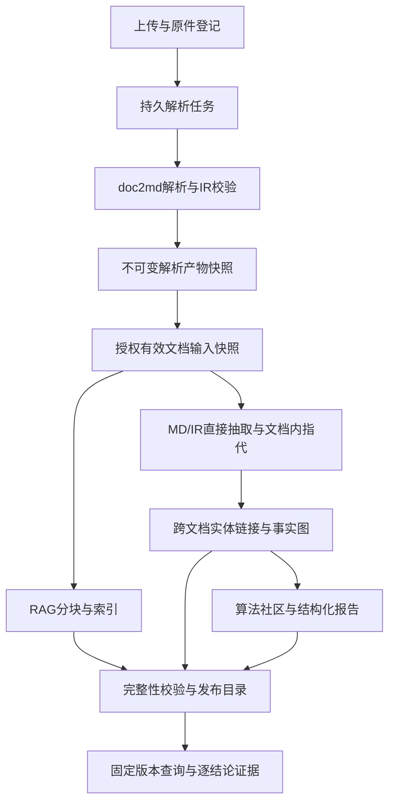

# LLMKE 统一文档处理与知识构建设计 V2.0

日期：2026-10-30
修订性质：设计与契约修订；**未实施、未投产，不是新的长程派工提示词**。
代码对照基线：LLMKE 3fea44e58b3e3a59a9796bf7f914fc34e4d8ddd7。
doc2md来源：用户提供doc2md.zip，SHA256=63eede32164a0c1c919428ef5cb6deadf19c8e76073841dc3aad61db0da32f26；交接代码基线52a63ec，详细设计以实际源码/裁定优先。
本轮目标约束：用户已确认所有支持格式的上传文件先经doc2md，RAG与GraphRAG共同消费结构化解析结果；保留完整知识库能力并精简交付。
本次不派发实现任务，不把生成合同视为实现已符合合同；待本设计与兼容边界核定后再形成实施拆分。

## 1. 重新核对后的关键结论

1. 原平台V1.0设计写的是alg-parse/deepdoc后接分块索引，没有doc2md不可变产物的边界；不能据此断言doc2md已成为唯一解析入口。
2. 已查旧解析loader仍有按后缀选择原件解析器的分支；不能据“上传成功”断言已经统一doc2md。整改不能只替换为“读取md字符串”，还须保留表格、图像和来源。
3. doc2md已有三件套、Document IR 1.0的schema/builder及纯校验器；提供的代码/交接材料同时明确，IR服务/CLI全链路未完成。函数存在不等于所有格式已稳定产出IR。
4. **parsed_text.md在doc2md中是证据字符区间的固定基准，不能改写；rendered.md才是派生展示。** 先前任务书“Markdown只是可读呈现”的表达不完整，现予更正。
5. 不另造一套与doc2md竞争的正文/表格/坐标模型。平台封装并版本化三件套、IR和资产；检索/图谱仅建立派生投影。
6. 社区与全局问答已由最新用户要求纳入目标范围；旧设计“只预留、默认不实现”的范围决定不再适用。M0效果评测继续保留。
7. 单客户私有化范围保持，不借本次修订新增SaaS多租户。知识库/文件授权域必须真实隔离。
8. 逻辑合同先于物理服务合并。Java单体、Nacos/MQ退出是部署收敛路线，不能掩盖数据契约未成立。
9. 采纳“图构建直接读取doc2md产物，跳过RAG预切片和ES中转”的解耦方向；不采纳“任意长文无须任何抽取窗口”的绝对化解释。ES不再是目标架构必需组件，全文/精确检索能力继续保留。
10. 首个图检索引擎适配目标改为HippoRAG；平台标准输入与GraphEnginePort独立于引擎。社区/结构化报告是独立能力，不把选HippoRAG等同于微软式社区已完成。

### 1.1 权威顺序与状态

用户最新确认 > 本次明确的差异决议 > 原设计仍有效约束 > 原始接口/表资产与当前代码事实 > 历史评估/转写参考。

doc2md原合同的冻结范围、旧UID、三件套、IR封闭字段和缺数据不编造要求保留。19项增强设计是候选方案，未确认/未实施部分不得当现成能力继承，也不将其银行源连接器范围移植进LLMKE。

设计细节采用本次版本化合同；运行、质量、业务签收和发布状态继续分别记录。

## 2. 业务范围和逻辑模块

完整范围继续覆盖C01–C20及原有效必选扩展：用户权限、知识库/文档、全部约定格式与OCR/VLM、结构与预览、分块、索引/混合检索、精排、问答/流式/历史、FAQ、表格/受控SQL、版本比较、本体与图谱、社区/global、安全、诊断、离线部署和恢复发布。

| 逻辑模块 | 责任 | 不拥有的责任 |
|---|---|---|
| 接入与文档域 | 原件登记、文件版本、授权、上传任务、有效性 | 不在Controller内做第二套内容解析 |
| 任务协调器 | 幂等任务、租约、状态、重试、outbox和发布CAS | 不把任务执行成功等同知识已发布 |
| doc2md解析适配器 | 路由、原生/OCR/VLM解析、质量、三件套/IR、资产 | 不决定知识库权限、不构建另一个知识库UI |
| 解析产物仓 | 原子保存、不可变快照、内容摘要、访问守卫 | 不根据用户传入路径访问任意文件 |
| RAG投影器 | 结构化分块、全文/向量/表格派生索引、配置版本 | 不重新解析原件、不生成图事实 |
| 图谱构建器 | 抽取、指代、身份链接、断言/来源账本 | 不把相似度或同名直接当身份相等 |
| 社区/报告构建器 | 同域同代图投影、层级社区、逐结论支持 | 不跨不可见资料聚类后再过滤引用 |
| 查询与证据组装 | 固定发布版本、检索/融合/精排、支持核验、回答 | 不把派生摘要冒充原文证据 |
| 前端与运维 | 正确显示各阶段状态、来源/社区视图、版本与运行诊断 | 不用一个“解析成功”代表全部能力就绪 |

逻辑模块可以合并部署，但所有者、输入输出和失败边界保持独立。

## 3. 总体数据流

上传成功只表示原件和任务已提交。doc2md完成后事件触发两条异步流水线；RAG不等待图模型全部完成。图谱、报告各有独立状态，global未就绪须明确返回NOT_READY，不能悄悄回答普通RAG又标称GraphRAG。

原文件可用于受控预览/证据核验；这些读取不属于下游重复解析建库。解析器内部可复用现有DeepDoc、MinerU、MarkItDown、原生Office、OCR/VLM，但须由doc2md入口治理并产出同一合同。

## 4. doc2md合同：复用、快照与结构

### 4.1 保护原产物

原三件套：
- parsed_text.md：不可变正文/证据基准；
- parsed_metadata.json：解析元信息；
- parse_manifest.json：原清单及原有键语义。

原document_ir.json遵守document-ir/1.0：13个顶层键、8类block、6类content_ref、确定性document_uid和b0001等局部块标识。未知bbox、页数和confidence为空，不估算。

IR1.0 cells不加入格级confidence，cell bbox仍按原合同为空。19项增强如原生Word合并格、表头/单位路径、坐标/流程/图表等需要额外信息，使用已版本化的增强伴随产物，不挤入旧IR的封闭对象。

### 4.2 平台封装ParseArtifact

平台新增的ParseArtifact是**产物清单和版本封装**，不复制另一套正文/表格定义。至少包含三件套、IR、对应资产的相对路径、大小、完整SHA256，以及：
- 实际doc2md代码/制品、parser_profile/adapter_version；
- 解析配置、模型与运行依赖指纹；
- 读取集合read_set摘要、结构能力/质量；
- 提交标识和不可变artifact_id。

三件套/IR的旧字节保持。parsed/by_hash目录可能被force重跑，因此平台不能把可变目录直接当长期引用：先从同一已完成read-set复制到独立staging、逐件校验，再原子提交不可变快照。复制期间源改变则放弃候选，不混合两次解析文件。

原清单里生产机绝对路径只作受控溯源信息，不作为新系统文件访问指令。平台用独立位置映射解析私有对象；公开API不返回生产机路径和秘密。禁止为“路径可搬迁”修改原manifest字节。

### 4.3 身份和幂等

| 对象 | 身份含义 |
|---|---|
| content_uid | 保留doc2md约定：等于原件SHA256 |
| file_id/document_version | 平台逻辑文件及其业务来源版本；相同内容不等于相同授权/来源 |
| doc2md document_uid/block_id | 原有局部身份保持；全局引用必须再带parse_artifact_id |
| parser_fingerprint | 代码、路由、模型/配置、adapter等实际影响解析的输入摘要 |
| parse_artifact_id | 一次已提交不可变产物身份；复用同一成功快照，不覆盖旧产物 |
| snapshot_id/input_digest | 一批有效文档与授权范围的确切解析绑定 |
| build_id | 一次RAG、图或社区投影构建；含输入与配置版本 |
| release_id | 指向同一输入快照的可查询投影集合 |

不要把原件SHA当完整解析版本，不把doc2md局部block_id当全知识库实体ID。模型重推理可能改变输出；显式重算产生新产物，不能承诺模型字节确定性。

### 4.4 能力接纳与IR缺口

所有新文件进入doc2md。适配器必须探测/声明实际能力，不能把旧parsed_text-only产物标作结构化完整。

- 原文档含表格而只得到扁平文字：PARTIAL/能力不足；不能当表格功能已完成。
- 原生Word表格从OOXML等保真来源获得合并格与单位；OCR模型结果是候选，格式有效不证明数值真实。
- IR服务/CLI未接线的缺口需要补齐producer出口；不得在RAG/GraphRAG再回原件补解析。
- inline_text不自动具有原文offset。新增parser_profile可以在不改MD的前提下，按真实字符位置生成新的IR text_span版本；旧IR保留。无法精确对齐的内容保留候选/图像来源，不伪造text_span。
- 表格/图片若未知页面坐标，使用单元格/资产级定位并如实显示，不估算页面坐标。

能力不满足时产生可诊断的状态与错误。合法空文件可以EMPTY；非空扫描页产出空文字需要质量核对，不能把模型失效当合法空。

## 5. 共享输入快照与独立投影

InputSnapshot由平台创建，包含scope、CURRENT/HISTORY_COMPARISON及逐文档ArtifactBinding，绑定原件、MD、IR和增强产物的准确摘要。

RAG与GraphRAG对同一文档消费同一解析版本，可有不同上下文单元：
- RAG保留策略化分块、表格检索视图、多叉树等经过验证的实现；
- 图抽取直接读取MD/IR，使用标题/正文/表头/单位/脚注等足够上下文，允许多个块组合；不领取RAG chunk或先查询ES。
- 两者的chunk/实体/断言都回引原始不可变产物，不能靠chunk编号猜来源。
- 历史ES中转路径只作为迁移期适配，不再作为目标依赖；新图路径必须能在RAG未构建、ES未启动时独立构建。

### 5.1 如何理解“GraphRAG直接从MD抽取”

应跳过的是**RAG的检索切片前置工序**，不是取消模型上下文边界。三个概念分别管理：

| 对象 | 用途 | 生命周期 |
|---|---|---|
| doc2md IR block | 标题、段落、表格、图片等原始结构定位 | 随不可变解析产物保存 |
| RAG chunk | 向量/关键词召回单元，可采用父子块或表格视图 | RAG策略版本控制 |
| GraphRAG extraction window | 一次模型抽取的输入上下文，允许重叠和补充表头/标题 | 图构建配置控制，与RAG chunk无依赖 |

短文在真实token预算与质量允许时整篇抽取；长文按章节/段落/完整表格边界构成窗口。窗口若仍过长，拆表须携带表头、单位、条件和脚注的来源，不能静默截断。实际输入tokens包含系统提示、正文、附加上下文和多模态开销，并预留输出。

新增GraphExtractionPlan，记录MD字符区间及摘要、来源、IR块覆盖、窗口输入hash、tokenizer/model预算、抽取配置。覆盖检查必须包括MD尾部；未对齐内容不能假装已处理。该计划是抽取执行清单，不是另一套正文存储。

整篇输入也不保证关系完整。跨章节指代/条件依赖可增加第二遍定向抽取，保存额外支持来源；跨文件关联在同域全库实体链接步骤完成。把所有文件拼入一次模型调用既不是“社区”的定义，也不是本设计要求。

官方GraphRAG也先形成TextUnits；自带documents输入能绕过其文件读取器，但不会自动跳过内部chunking。接官方Standard时必须明确内部TextUnit到原MD的映射；BYOG只覆盖图之后的社区/报告步骤。不能宣称“官方天然整篇无切片”。来源见05_ES_AND_GRAPH_INPUT_DECISION.md。

更换RAG分块策略只重建受影响RAG投影，解析器不变时不重复OCR。更换抽取/本体/社区配置重建相应图派生物，不改MD；解析产物变化则两条流水线都按依赖失效。

CURRENT每个逻辑文件只选一个有效来源版本。历史比较使用显式历史快照；本版本不将历史冲突版本混入现行图。

## 6. 图事实、跨文档合图与社区

### 6.1 实体与断言

文档内先处理“该产品”等指代，再在同授权域快照内进行实体候选召回与身份判断。embedding仅召回候选，不做传递性身份裁决；同名异体不合并，跨文件别名有支持才归一。

实体ID与展示名称分开。M1类型码以受控原清单为准，不因实施方便换成通用NER类型。

断言保留方向、谓词、对象和适用限定：
- 对称谓词才可无序去重；
- 总额/分项角色来自原文，不按最大值推断；
- 数值用Decimal字符串，保留单位、币种、比较符、DELTA的正负与基准；
- 时间/政策版本、客户对象和担保方式不应在归一时抹除；
- 一个事实的多份来源取并集，删掉一份来源不误删仍被支持的事实。

无来源或支持不足的候选不得进入可发布事实图。不得通过空file_id等降级宣布成功。

### 6.2 社区与报告

知识库统一图允许多个真实分量；文件不是社区，社区也不等于KB。算法输入由完整有效顶点集和有向事实的无向加权投影构成，合法孤点明确保留，不因MATCH只读有边点而消失。

优先原设计Leiden，使用其他算法需明确等价范围；Louvain拆分连通分量只保证拆分后的连接性。算法不负责补出不存在的业务关系。

报告包含结构化findings与支持图：一组内全部前提AND，不同完整支持组可为OR。支持项可直接引用SourceRefV2，也可引用受支持的图谱断言；普通RAG不依赖图谱构建。保留完整来源集合；显示引用截断不删除底层血缘。标题/摘要中的关键事实也须关联findings。

HippoRAG作为首个图检索适配目标，隔离于GraphEnginePort之后；微软GraphRAG可作为其他适配器/社区组件候选。BYOG仅验证社区/报告，Standard才覆盖抽取流程，不能把这些直接当HippoRAG能力。适配层仍负责域、本体、原文与版本。

### 6.3 标准输入与引擎隔离

KnowledgeInputBundle绑定doc2md原产物、IR/资产和DocumentSemantics伴随文件；后者规范表头/单位/脚注、图片OCR/描述/图表数据/流程节点关系。图片解释保持MODEL_INTERPRETATION与候选状态，不能回写原MD充原文。

GraphEnginePort只暴露版本化构建、索引状态、候选检索和能力声明；HippoRAG类、native chunk ID与私有图格式留在适配器。相同文本跨文件去重需要多来源映射。检索结果声明GRAPH/DENSE_FALLBACK与真实trace，不以HTTP成功认定图已生效。详见06_STANDARD_INPUT_AND_GRAPH_ENGINE.md。

切换引擎允许重建引擎私有索引，不重跑未变化的doc2md解析；不承诺原生索引互读、效果相同或零迁移。社区处理器消费经校验的标准事实，不能盲用native相似边生成金融断言。

## 7. 证据与引用

文本坐标以冻结parsed_text.md的UTF-8解码Unicode码点计算，左闭右开。新V2不隐式改换行、Unicode正规化、空白或表格渲染；若旧产物坐标来自不同解码规则，必须核验/显式转换，不能补默认parser_version宣布兼容。

SourceRefV2携带file/version/artifact、MD/IR摘要、block_id和类型化locator：
- text_span：确切区间和quote_hash；
- table_cell：table_id及真实锚点行列和单元格文本摘要；
- figure_asset：figure_id及真实图像摘要。

文字区间不对应图片/表格时不得强行填offset。视觉模型解释标MODEL_INTERPRETATION，不伪装为原文逐字引用；金融精确数值须有原表/可见标签等可验证依据。

旧SourceRef的chunk_id不是解析文档身份。V1/V2显式版本适配，旧不明来源不能升格为完整V2证据。既有SQL/Web证据合同继续有效，不强行套入上传文件doc2md路径；查询文本embedding也不需要先解析文件。

schema/哈希/引用存在性只能证明结构一致；命题、单位、条件及原文是否充分支持还需要独立业务题与核验。不能声称CI可以机械证明全部语义。

ContextManifestV2固定release/input/scope与实际选用来源、断言、社区报告。普通RAG可直接使用原文支持项，assertions可以为空；图谱不是其前置服务。TokenBudgetV2复用旧合同的标量约束，但将路线改成dense/lexical/exact/graph/community等逻辑能力，不再把es/milvus产品名写进新路线预算。旧TokenBudget保持原样。

## 8. 授权与信息隔离

沿用单客户部署的KB/文件授权。AuthContext、service_identity、auth_version/resource_version由平台核验，算法不得相信用户传入的spaceName、scope或路径。

构建scope必须对应受控可见文档集合；检测、实体归一、报告和缓存均限制在该集合，不能对含秘密资料的全图先聚类再过滤引用。多种可见性可按可见集合等价类复用构建；复杂域组合没有实现前，明确返回尚不支持，不能冒称文件级隔离已完成。

撤权/删除事务先提交query fence与版本更新，再异步清理派生存储。后续读取和流式发出前复核当前围栏；已发出的历史内容无法撤回，不能作不可能的保证。旧发布版本不得绕过当前权限。

Python任务worker通过协调器领取任务、续租与回传，不直接修改LLMKE的用户/KB/对话/任务业务表。doc2md现有自身登记库属于原项目依赖，接入时与LLMKE表隔离；不因此自动获得LLMKE库权限。

## 9. 任务、事件、状态与发布

### 9.1 事务和租约

原件登记＋来源版本＋任务/outbox在平台事务提交。任务执行为至少一次；各阶段产物幂等，event_id同摘要重投可重放，异摘要冲突隔离。

领取/续租/完成由协调器管理短事务和fencing token。Python计算不持有长数据库事务；旧租约执行者不能发布。取消、超时、重试耗尽、依赖缺失、合法空各自可见。

逻辑事件不绑定新MQ产品。可以由已有broker或协调器MySQL outbox承载，协议语义相同。

### 9.2 分离状态

| 对象 | 状态/含义 |
|---|---|
| 解析任务 | QUEUED/RUNNING/VALIDATING/SUCCEEDED/FAILED/CANCELED |
| 产物质量 | COMPLETE/PARTIAL/EMPTY；成功提交不等于所有能力齐全 |
| 投影构建 | QUEUED/RUNNING/READY/READY_EMPTY/FAILED/CANCELED/INVALIDATED |
| 发布目录 | CANDIDATE/PUBLISHED/INVALIDATED |
| 各通路就绪 | NOT_REQUESTED/PENDING/READY/READY_EMPTY/FAILED/INVALIDATED |

前端分别展示这些维度。RAG可以先就绪；图与报告尚在构建时global返回NOT_READY。READY_EMPTY表示真的无证据，不自动当模型错误或有内容成功。

### 9.3 原子发布与并发

各存储先写staging/new-generation，校验来源、预期覆盖和输出清单后，MySQL CAS激活KnowledgeRelease。一次请求固定release/input_digest，不混合新旧RAG、图与报告。

发布目录可只允许RAG，其他通路PENDING；它不能把global标READY。社区READY必须引用对应READY图构建。完整知识库交付仍须实现全部必选通路，部分就绪不是全部交付。

候选的auth/resource输入已过期则拒绝激活。回退仅指向仍有授权且输入有效的已校验版本，不回退到受损或已撤权旧图。历史产物按既定留存政策保留，不自动DROP表或删除原件来“回滚”。

## 10. 接口、错误与兼容

新增V2合同在contracts/schema、api、events、evidence、rules、evaluation注册；旧v1 schema和API字节保留。新建/重建走V2域对象，旧路径通过明确适配进入，不允许一条路径悄悄混两套SourceRef语义。

内部parse-jobs只接受平台的对象ID与核验上下文，不接受任意外网URL/主机路径。回执需与任务、原件、版本、租约一致。协议定义不代表HTTP实现已经存在。

V2独立定义PARSE-201…205、PIPELINE-201…202，并复用Auth/Request等既有码。它们尚未加入旧v1闭集，旧端点按已定义兼容映射返回；不能将新码直接塞给拒绝它的旧客户端。

源码旧37表及doc2md原22表不因本设计自动变更。平台新元数据的逻辑关系先确定，增量表/列要基于真实DDL形成迁移草案并在恢复副本验证；不再用字段数、ORM或“零迁移”口号代替审查。

## 11. 存储与逻辑数据关系

平台至少需要持久保存以下关系，优先复用现有对应表，不据此声称已有物理列：
- 文件版本 → 原件对象/哈希/当前有效性/权限策略；
- 解析任务 → 输入指纹/租约/状态/产物；
- 解析产物 → 不可变部件清单/质量与代码配置；
- 输入快照 → 有效文件版本及解析绑定；
- 构建 → 快照/配置/输出/依赖；
- 发布 → 同快照各通路构建/就绪/CAS版本；
- 断言/报告 → 完整来源支持与依赖；
- 事件 → 负载摘要/提交与消费状态。

全文、向量、图是可重放投影。保留现有MySQL业务元数据、不可变对象、向量和图存储的有效实现；ES从“必选默认”改成“迁移期可选适配器”。新Graph构建不经全文索引读取输入。共用内容的去重不能代替各来源授权，不能通过一个content hash端点暴露别人的文件。

### 11.1 去ES的能力承接

目标精简profile关闭ES。若目标Milvus版本及离线依赖满足要求，优先用同一Milvus承接dense+BM25，MySQL承接明确的业务标识字段精确查找；这是待验证候选，不是当前实测结论。不满足时评测现有MySQL ngram全文方案，不能为“去ES”直接取消关键词召回。MySQL ngram不是ES功能和评分的等价替代。

RetrievalProfile明确dense/lexical/exact后端、实际版本、中文分析配置和验收状态。只有替代能力验证完、全部ES调用点有去向，才能在迁移窗口停ES。候选profile不允许直接标VERIFIED。准确率、容量、P95和资源目标先从当前产品与目标机实测取得，不编造阈值。

迁移清单必须覆盖全文检索、邻近块、原文/图片回查、社区报告存储、任务扫描、统计和索引管理等实际调用职责；不只替换search函数。拒绝旧客户端显式要求es路线时暗中换后端仍报es成功；V2调用方改用逻辑路线，旧接口保留明确的不支持/降级语义。

## 12. 精简部署设计

目标逻辑部署：一个Java业务应用＋任务协调器，doc2md/知识计算worker，真实模型服务，必要存储和静态前端。算法CPU/GPU角色可按资源隔离，不强制一锅依赖。

Java业务模块可合进一个Spring Boot，不把WebFlux Gateway与MVC控制器混塞。入口路由可用既有nginx；鉴权/对象授权仍在应用落实。Nacos退出以所有Java/Python配置读写被承接为条件；MQ退出以全部消息职责被持久任务/outbox承接为条件。

doc2md不是现成无状态库：当前Router/ParserService创建自身MySQL session。适配可先复用原登记流程并隔离其已有schema，或在不改冻结合同的前提下提取窄的解析port。不可把“包装一下”当作已证实低成本，也不复制一套内容仓/搜索UI。

不把本次设计扩展成全量PostgreSQL迁移。先获得数据流与合同一致，再验证组件净减、Python共享层和模型去重。离线交付分运行、固定环境、模型、源码/离线构建资产；拆包不等于总量减少。

另发现框架requirements.lock混入CAD等无关包及冲突版本；不能全量pip freeze充当产品运行依赖。本设计自查使用独立最小工具环境，未改生产依赖；实际运行锁须按真实import/制品生成并实测断网安装。

## 13. 验证分层

| 能证明的内容 | 验证方法 |
|---|---|
| JSON/OpenAPI形状、引用与枚举 | 标准schema/OpenAPI检查 |
| 部件哈希、区间、同快照绑定、完整支持前提、就绪条件 | 本包一致性检查器及正反例 |
| doc2md完整IR约束 | 原项目validate_document_ir和相应冻结测试 |
| 所有格式与表格/图像信息保真 | 真实模型/引擎和原始资料对照 |
| GraphRAG实际消费及效果 | 标准/组件对照、调用trace、跨文档诊断与业务留出题 |
| 授权非干扰、租约/CAS、崩溃恢复 | 真实系统故障/撤权/并发测试 |
| 投产与离线可交付 | 干净目标环境实装、完整业务回归、升级恢复与实际发布 |

本包合同样例为合成数据，仅证明合同自洽，不充抵A01–A17、C01–C20、目标发布或真实业务验收。DV-01…26登记目标用例，初始NOT_EXECUTED。窗口覆盖检查只校验清单和声明的token数；模型实际收到什么仍须输入trace与真实token计数核验。

## 14. 原设计和旧任务书的处置

本设计替代旧V1.0的解析/共享产物/图谱可选范围及隐含部署前提；保留双栈复用、固定可解释检索、策略分块、历史比较、接口兼容及安全要求。逐项差异见03_CONTRACT_CHANGE_MATRIX.md。

R15/R15L任务书中依赖旧边界的未执行派工暂缓，历史实现和证据不删除。旧prompt只作为历史记录，待本设计核定后重新拆实现任务；本次交付不包含新的“立即开发”指令。

## 15. 尚缺材料与禁止结论

- 提供的doc2md源码/交接包是2026-10-17快照；尚未验证其最新源码、当前运行版本和19项增强完成度。
- 尚无目标环境所有格式的统一产物实测、真实DDL恢复副本结果、完整模型/离线资产当前清单。
- 官方内核同语料效果与成本仍需实跑；没有证据认定必须整体替换或不替换。
- 本次没有独立外部QA签署、业务验收或生产发布；文件存在和自查通过不代表这些完成。
