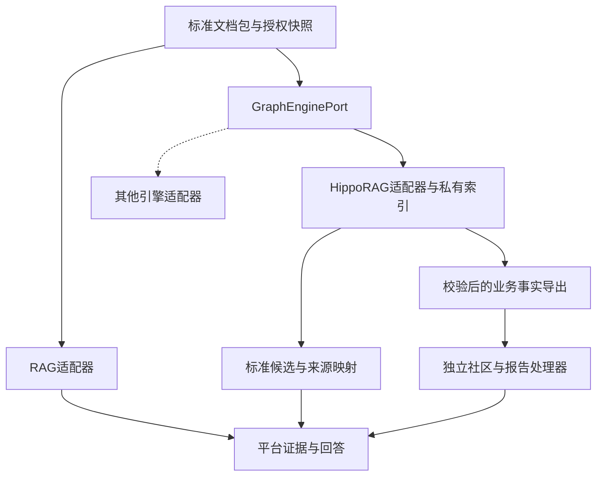

# 标准知识输入与可替换图引擎

版本：KnowledgeInput 1.0 / GraphEnginePort 1.0，归入统一设计V2.0。
日期：2026-10-30。状态：设计和合同已编制；HippoRAG适配器未实现、未跑模型。

## 1. 架构裁定

采纳HippoRAG作为首个图检索引擎适配目标。平台掌握文档、权限、版本、标准来源、业务事实和最终回答；HippoRAG掌握其内部OpenIE、索引、图传播和候选召回。业务接口与数据库不保存HippoRAG类、pickle、native chunk ID或内部图属性作为公共身份。

“以后可换”具体指：更换适配器和引擎私有索引，重建后切发布指针，上传解析、知识库/文件身份、前端查询入口、来源引用和验收题保持。**不承诺已有引擎索引能直接给另一引擎加载，也不承诺免重抽取、免向量化或效果相同。**

社区/报告是独立逻辑能力，可与计算worker同进程部署，不要求增加一个微服务。首次接入HippoRAG不意味着已实现全库社区/global。

## 2. 第一层：标准文档包

不另造第二套正文IR，封装现有doc2md产物。每份文档至少有：

| 文件/对象 | 规范与用途 |
|---|---|
| `parsed_text.md` | UTF-8不可变正文；字符offset证据基准 |
| `parsed_metadata.json` | 原doc2md元信息，保留原有键语义 |
| `parse_manifest.json` | 原清单与资产摘要，原字节保留 |
| `document_ir.json` | document-ir/1.0；块、表格矩阵、图片及来源定位 |
| `assets/images/*` | 图片原资产；相对路径与SHA256核验，受平台访问控制 |
| `document_semantics.json` | 新伴随合同llmke-document-semantics/1.0；可缺省，缺少不等于已完成图片/表格理解 |
| `ParseArtifact` | 上述原解析产物的不可变清单，不内嵌原正文副本 |
| `KnowledgeInputBundle` | 同一授权域快照的文档bindings和语义伴随文件bindings，不含引擎私有字段 |

生产文件名可映射至受控对象ID，合同不允许任意主机路径成为读取指令。原doc2md内部目录可能force覆盖，平台快照仍需不可变复制和摘要核验。

`DocumentSemantics`不改写MD或旧IR。其SHA256放入对应ArtifactBinding.enhancement_manifest_hash并参与InputSnapshot.input_digest。语义文件变化使下游构建失效；不能在保持旧摘要的情况下替换图片解释。图引擎与RAG选同一语义版本，但各自可以使用不同的派生输入单元。

## 3. MD、表格与图片的结构定义

### 3.1 正文

IR按reading_order提供heading/paragraph/table/figure等块。text_span指向MD真实Unicode码点区间。保留标题层次和块顺序；旧inline_text没有精确坐标时不能假填offset。

### 3.2 表格

原始数据仍在IR.tables：table_id、block_id、n_rows/n_cols、cells；cell固定row/col/rowspan/colspan/is_header/text/bbox，不添加旧合同禁止的confidence。合并格只存真实锚点，覆盖位置不能冒充另一个原始cell。

新增TableSemantics补充：

- `header_paths`：数据锚点cell对应的多级表头锚点路径；
- `unit_annotations`：单位/币种、适用数据cell、单位说明原文来源；
- `footnotes`：脚注及来源；
- `statements`：需要推理才能得到的表格解释，保留CANDIDATE/SUPPORTED/REJECTED状态。

输入单元序列化表格时同时带表名/章节、完整表头路径、单位、适用条件和脚注；不只拼数据行。正负号、范围、总额/分项以及基准利率不允许归一抹去。

### 3.3 图片及理解结果

原始来源在IR.figures：figure_id、block_id、asset_path/hash及可得页面定位；未知页码/bbox如实null。新增ImageUnderstanding包含：

| 字段 | 内容 |
|---|---|
| `figure_id/asset_sha256` | 绑定实际图像，不以图片文件名猜关联 |
| `kind` | PHOTO / CHART / FLOWCHART / DIAGRAM / FORMULA / OTHER |
| `ocr` | 带来源与核验状态的OCR陈述 |
| `description/observations` | 图像解释陈述，含observation_class和verification |
| `chart_data` | 可选坐标轴标签、系列及数值字符串点；+30、-20保留符号，每点带来源和状态 |
| `diagram_data` | 可选局部节点/有向关系及来源；局部节点ID不是全库实体ID |
| `model_fingerprint/prompt_hash` | 实际生产解释的模型和提示词指纹 |

VLM解释属于MODEL_INTERPRETATION，默认候选。不能把它插回原MD当逐字原文，也不能仅凭“模型自信”宣称金融数值已被支持。SUPPORTED需要平台规定的原图/原表对照和验证记录；结构校验不证明数值正确。置信度不是事实性保证。

已附可打开核对的合成样例：examples/multimodal/，包含MD、3×2表格、图片资产、IR、+30/-20 BP与LPR基准、候选图片解释。这不是doc2md或模型的实际输出。

## 4. 第二层：引擎输入单元

EngineInputUnit是**可重建的模型执行输入**，不成为另一套权威正文：unit_id、parse_artifact_id、TEXT/TABLE/IMAGE_INTERPRETATION、渲染text及hash、render_profile、source_refs、observation_class和statement_ids。

短MD可整篇成为输入单元；长MD采用独立GraphExtractionPlan，跳过RAG chunk但遵守模型上下文预算。正文/表格/图片解释可按结构组合；所有渲染文字必须映射回实际来源或明确标为模型解释。派生表格/图片文字的临时offset不能代替MD原offset。

适配器若再次内部切分，必须导出native unit→平台unit/来源的完整映射并核验覆盖。不能仅保存一个file_id，也不能凭同名文本随意反查来源。引擎内部跨文件文本去重后，映射仍是**native_id → 多个input_unit_id → 多个真实SourceRef**。

## 5. GraphEnginePort最小公共操作

机器合同：`contracts/api/llmke-graph-engine-v1.openapi.yaml`。

| 操作 | 输入 | 输出/边界 |
|---|---|---|
| describe | 服务身份 | 引擎/适配器/锁文件版本、声明能力、已验证能力 |
| build | 受控bundle ID/hash、服务端engine_profile、build/fencing token | staging索引；校验后才READY，未完成的hash可null |
| get index | 受控engine_index_id | 同scope/snapshot、输入映射和引擎产物摘要 |
| retrieve | 固定release/index/snapshot/scope、query、top_k | 标准hits/来源，明确GRAPH或DENSE_FALLBACK及原因 |

Python库内部调用和HTTP worker可以共享此语义；本合同不强制引入RPC、MCP或新的网关。业务层不import hipporag，只有适配器依赖它。供应商特定参数置于服务端profile，前端不直接传native配置。

增量、删除、图导出与社区/报告分别声明能力，不用空实现伪装共同接口。首版可通过新隔离快照全量重建支持文档删除；在新索引完成前撤权fence必须先阻止旧索引读取。

## 6. HippoRAG已核对事实及接入约束

读取2026-10-30在线官方main的README与`src/hipporag/HippoRAG.py`，尚未锁定安装版本、运行官方模型或做同语料实测：

- `index`接收字符串/Chunk，经preprocessor，分别编码passage/entity/fact；`retrieve`包含事实召回、筛选、稠密评分及PPR。
- `index`用正文内容hash定位chunk，并在重复chunk的metadata不同的时候警告、替换metadata。平台必须保留多来源映射，不能把native metadata视为唯一来源账本。
- `retrieve`文档说明：无相关事实的情况可回退稠密召回。因此返回200/有答案不能证明图路径实际执行。

源码：<https://github.com/OSU-NLP-Group/HippoRAG/blob/main/src/hipporag/HippoRAG.py>；用法：<https://github.com/OSU-NLP-Group/HippoRAG/blob/main/README.md>。以上仅对应所读版本；最终选版须复核。

适配约束：

1. 一个引擎索引只绑定一个授权可见集合与快照，模型组合/配置变化新建私有索引。不以最终hits过滤替代图传播前隔离。
2. 使用retrieve返回候选，最终回答仍由平台统一组装、核验和引用；不让引擎rag_qa绕过引用/权限/流式合同。
3. HippoRAG的检索图是算法结构；其无向投影、相似边不自动成为业务关系。平台的方向、单位、条件与原文支持必须保留在标准断言中。
4. 公开API里未核定平台所需的社区/逐结论报告合同，不宣称已具备。社区/global由独立处理器消费**经原文和本体校验的标准事实导出**；若导出不足以支持，状态BLOCKED/NOT_READY，不用普通RAG顶替。
5. `executed_route=GRAPH`须有实际图执行trace；普通查询允许明确的DENSE_FALLBACK，强制图验收查询不能以回退通过。
6. 私有序列化产物仅来自受信构建，不接收上传文件充当引擎索引；平台公共资产不使用pickle作为交换规范。

### 6.1 实施状态（2026-11-03）

第 4 条的能力边界仍然成立，但接线状态已变化，按实际写：

- **已接线**：建图完成后由快照的 OpenIE 结果 + `sources.json` 建断言层，生成 `community.json`
  （社区成员、代表事实、来源、逐条引用校验）；`POST /v2/graph/global` 返回
  `answer + citations + citation_check`；19532 的 `/retrieval_documents_global` 转发该端点，
  `health.community` 暴露社区数与引用失效数。
- **实测**：12 篇语料两次建图分别 68 / 72 条事实 → 33 / 34 个社区，引用失效 0；
  `/v2/graph/global` 与 shim 均 200，答案逐条带来源；反例（删 `sources.json`、
  换成幽灵 `file_id`）分别返回 `SOURCES_MISSING` / `CITATION_INVALID` 且答案为空。
- **不宣称**：
  1. 不做自然语言综合——`answer` 只逐条拼装报告里带来源的事实，避免无来源结论；
  2. 相关社区选择用字符二元组重合度，不是语义排序；
  3. 同一快照重复生成逐字节可复现；两次同输入建图因上游 LLM 抽取 68/72 波动，
     端到端不可复现；
  4. Java 侧只有 `/qa/ai/question` 有 global 分支，`retrieveDocs4Plat` 没有；
  5. `generate_community`、`del_space`、`del_doc_entity` 仍为 501（未接，不用假 200 顶替）。

结论：可以说“社区报告已接到 HTTP 并可被 shim 消费”，不能说“global 回答质量/跨机确定性已验证”。

## 7. 换引擎的判据与成本边界

- 从同一KnowledgeInputBundle重放，不重跑doc2md；只有源解析变化才重解析。
- 两个适配器互不import，独立环境/输出目录；无第二个真实引擎对照时，只能说接口设计可替换，不能说切换已验证。
- 相同前端/API请求能得到相同结构、可核验来源和真实路线；答案质量、延迟、构建时间可不同，逐题评测。
- 新索引校验完CAS切release，失败仍保留旧可用且未撤权的release；没有跨引擎原生索引兼容的承诺。
- 切换影响适配器、私有索引和能力选择；文档包、权限域、证据身份及业务流程不随供应商改写。

尚缺：HippoRAG锁定commit/依赖/模型服务、标准化图事实导出可行性、中文金融语料抽取与回指质量、目标机资源与断网安装实证。缺这些时不得标记HippoRAG已接入或社区已生效。
